# Registro Visual de Evidencias de Integración (Evaluación 2)

**Fecha:** 04/11/2026  
**Responsable:** Etienne Araya (`maikfeouWu`) — Calidad e Integración (CA1 / CA2)  
**Marco:** Evaluación 2 · Interoperabilidad con la Plataforma TicketU

---

## 1. Integración I2: API Gateway (:8080)

### 1.1 Healthcheck del API Gateway
Validación del estado operativo del Gateway y módulos registrados:
- **Ruta:** `GET http://localhost:8080/health`
- **Resultado:** HTTP 200, servicio `ticketu-api-gateway` activo con ruta `organizador` enlazada.

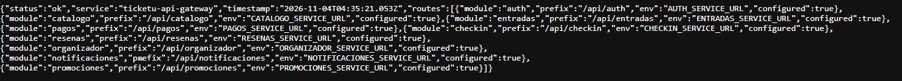

---

### 1.2 Catálogo: Consulta Pública de Eventos Próximos
Acceso a eventos del Panel Organizador a través del API Gateway:
- **Ruta:** `GET http://localhost:8080/api/organizador/v1/organizador/eventos/proximos`
- **Resultado:** HTTP 200 con la lista de eventos en estado `PUBLICADO`.

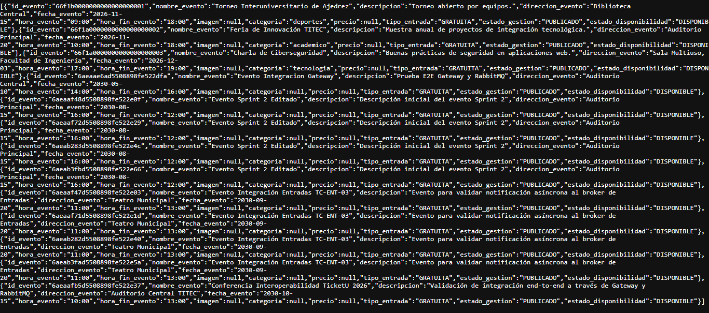

---

## 2. Integración I1: Broker RabbitMQ (`ticketu.events`)

### 2.1 Exchange Central en la Consola Web de RabbitMQ
Verificación del exchange en la infraestructura compartida de la plataforma TicketU:
- **Consola:** `http://localhost:15672` (vhost `ticketu`)
- **Exchange:** `ticketu.events` (tipo `topic`, durable).

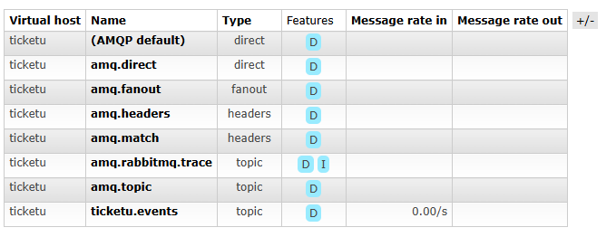

---

### 2.2 Despacho Transaccional en MongoDB (`mensajes_salientes`)
Verificación de los mensajes persistidos por el Outbox Relay en el contenedor de integración:
- **Contenedor:** `panel-organizador-integracion-organizador-mongo-1`
- **Colección:** `mensajes_salientes`
- **Resultado:** Mensajes para `panel.evento.entradas.v1` y demás squads con estado `ENVIADO`.

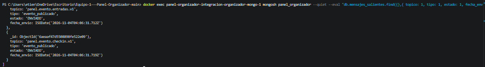

---

## 3. Verificación Automatizada: Newman vía API Gateway (:8080)

### 3.1 Suite Completa de Contrato e Integración (100% Éxito)
Ejecución de los 32 casos de prueba (incluyendo TC-ENT-01, TC-ENT-03 y TC-ENT-04):
- **Comando:** `npx newman run postman/panel-organizador.postman_collection.json -e postman/gateway.postman_environment.json`
- **Resultado:** 32 requests ejecutados, 56 assertions, **0 fallos**.

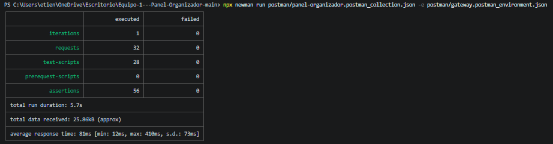

---

## 4. Sesión de integración completa en `plataforma-eventos-net` (17–18/11/2026)

Servicios **reales**: API Gateway, RabbitMQ, Auth (Keycloak + seed QA), Entradas / Inventario y Panel. Detalle en [`../sesion-integracion-2026-11-17.md`](../sesion-integracion-2026-11-17.md). Las capturas del navegador se tomaron con Microsoft Edge automatizado (la barra gris superior indica la URL abierta). Las de terminal son la salida real de los comandos, convertida en imagen.

### 4.1 Servicios levantados
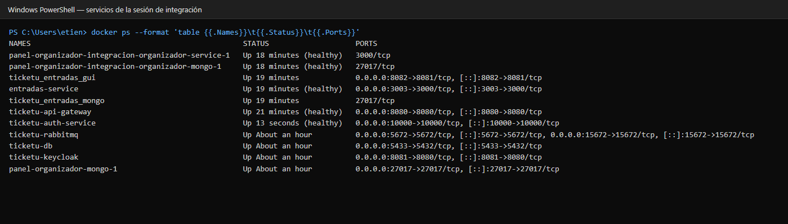

### 4.2 Auth
| Captura | Qué demuestra |
|---|---|
| 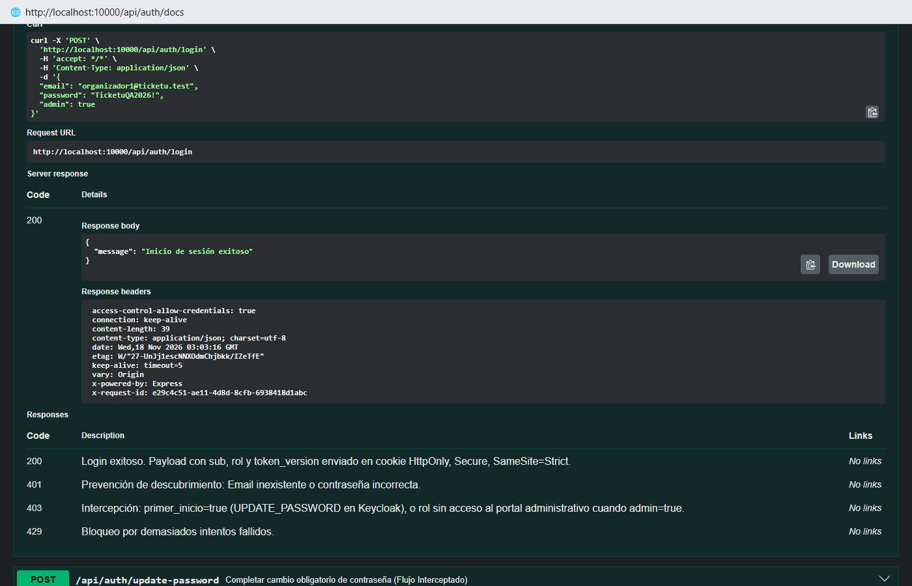 | Login real de `organizador1` en Auth (`POST /api/auth/login`): **200 "Inicio de sesión exitoso"**; Auth entrega la cookie `jwt` (HttpOnly). |
| 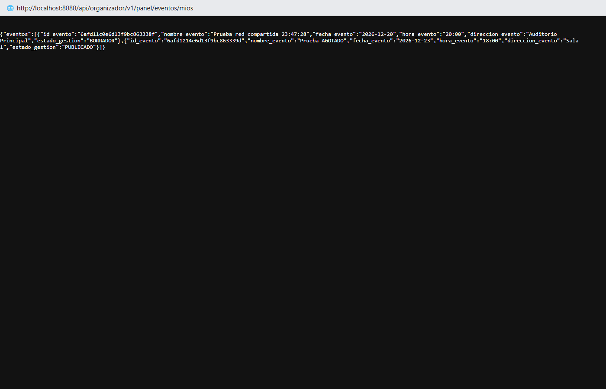 | Con esa cookie, el Panel **por el API Gateway** (`:8080/api/organizador/v1/panel/eventos/mios`) responde 200 con los eventos del organizador. |
| 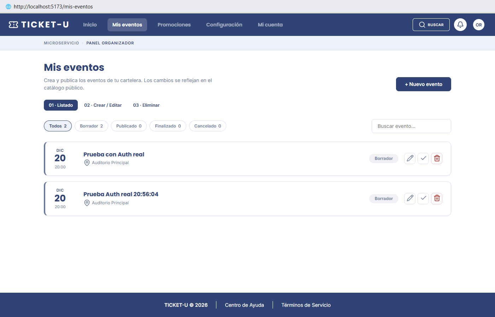 | La pantalla "Mis eventos" del Panel con la sesión real de Auth, sin login simulado. |
| 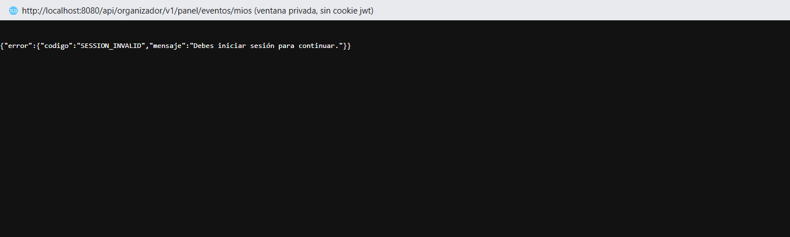 | Sin cookie, el Panel por el Gateway responde **401 `SESSION_INVALID`**. |
| 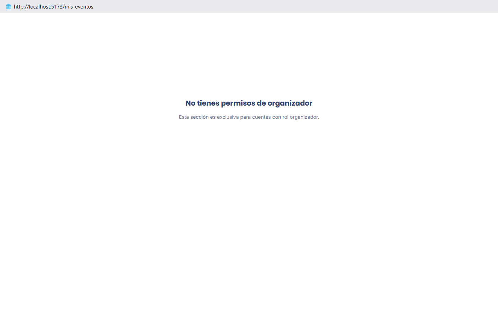 | `comprador1` inicia sesión en Auth, pero el Panel lo rechaza: **sin rol organizador**. |
| 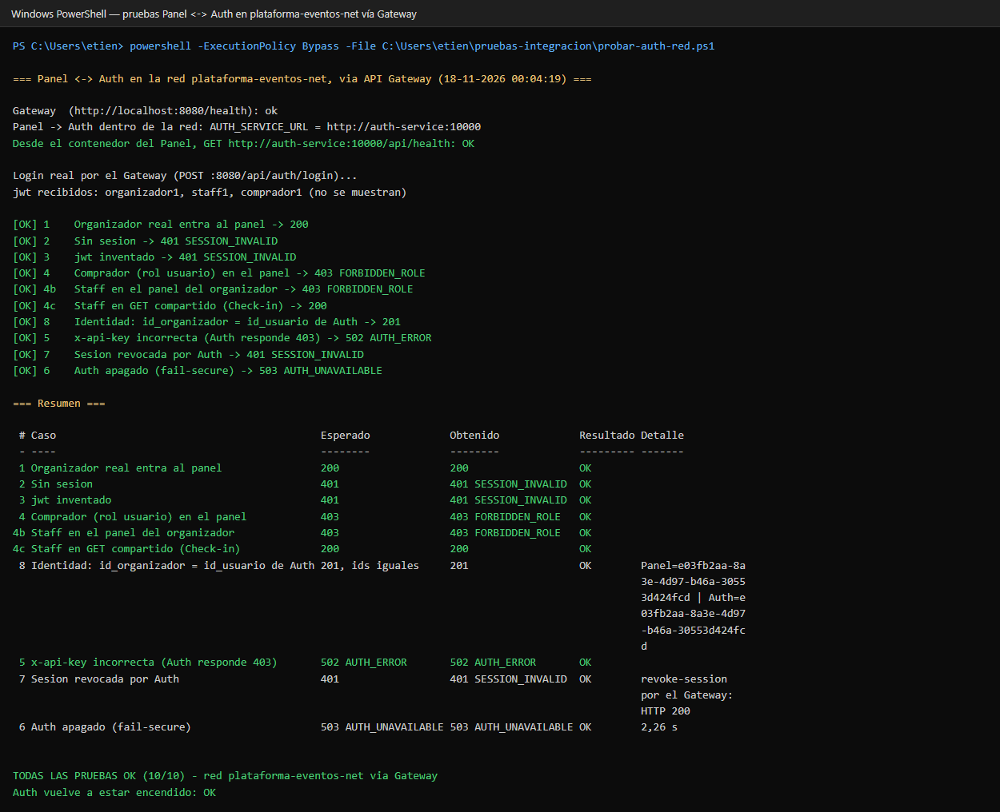 | Los 10 casos del contrato en la red compartida, vía Gateway (Panel → `auth-service:10000`): **10/10 OK**. |
| 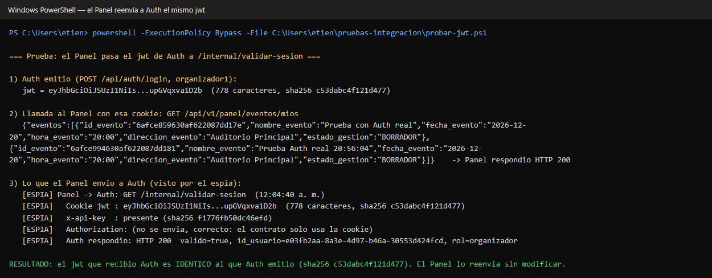 | El jwt que recibe Auth en `/internal/validar-sesion` es **idéntico** (misma huella SHA-256) al que Auth emitió. |

Las capturas 4.2.3 y 4.2.5 usan el frontend propio del Panel (`:5173`), que llama a la API del Panel en el host, conectada al mismo Auth.

### 4.3 Entradas / Inventario
| Captura | Qué demuestra |
|---|---|
| 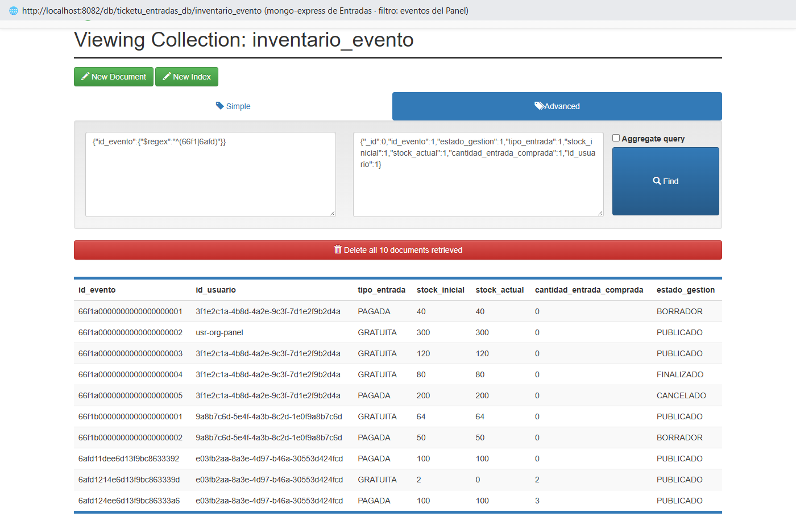 | **I1**: los eventos del Panel en `inventario_evento` de Entradas (su mongo-express). También se ven los hallazgos H2 (evento `6afd124e…` con 3 vendidas y stock de vuelta en 100), H3 (evento `6afd11de…` eliminado en el Panel, que sigue PUBLICADO) y H6 (`usr-org-panel`). |
| 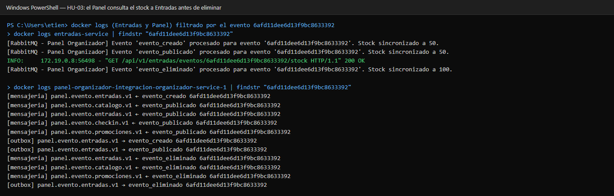 | **I2 + HU-03**: al eliminar, Entradas registra `GET /api/v1/entradas/eventos/{id}/stock` desde el contenedor del Panel (`172.19.0.8`). |
| 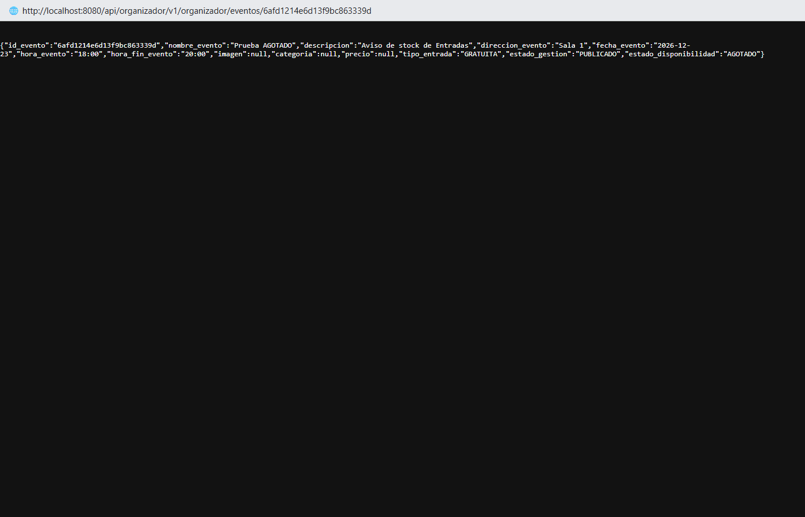 | Aviso de stock: después de `entradas.evento.stock.v1`, la consulta pública por el Gateway muestra `estado_disponibilidad: "AGOTADO"`. |

### 4.4 Broker
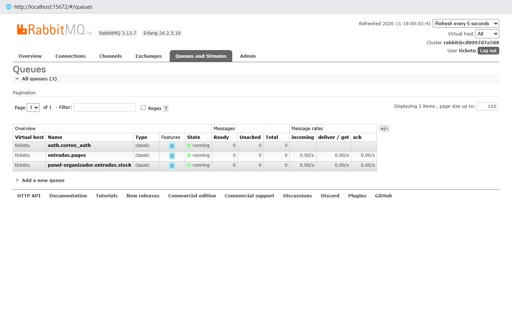

Cola durable `panel-organizador.entradas.stock` del Panel (ADR-0018) junto a las de Entradas y Auth, en el vhost `ticketu`, sin mensajes pendientes.
