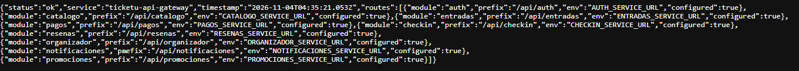
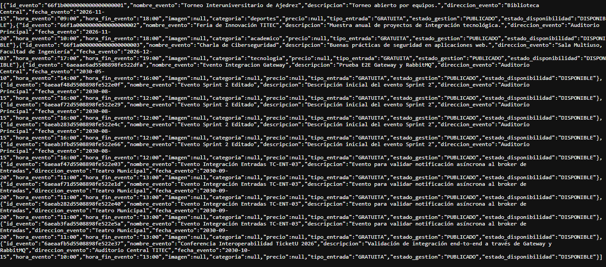
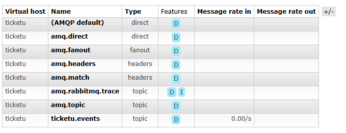
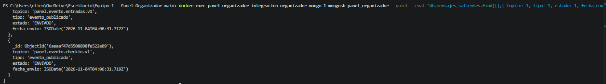
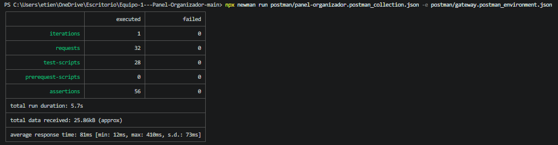

# Registro Visual de Evidencias de Integración (Evaluación 2)

**Fecha:** 04/11/2026  
**Responsable:** Etienne Araya (`maikfeouWu`) — Calidad e Integración (CA1 / CA2)  
**Marco:** Evaluación 2 · Interoperabilidad con la Plataforma TicketU

---

## 1. Integración I2: API Gateway (:8080)

### 1.1 Healthcheck del API Gateway
Validación del estado operativo del Gateway y módulos registrados:
- **Ruta:** `GET http://localhost:8080/health`
- **Resultado:** HTTP 200, servicio `ticketu-api-gateway` activo con ruta `organizador` enlazada.

---

### 1.2 Catálogo: Consulta Pública de Eventos Próximos
Acceso a eventos del Panel Organizador a través del API Gateway:
- **Ruta:** `GET http://localhost:8080/api/organizador/v1/organizador/eventos/proximos`
- **Resultado:** HTTP 200 con la lista de eventos en estado `PUBLICADO`.

---

## 2. Integración I1: Broker RabbitMQ (`ticketu.events`)

### 2.1 Exchange Central en la Consola Web de RabbitMQ
Verificación del exchange en la infraestructura compartida de la plataforma TicketU:
- **Consola:** `http://localhost:15672` (vhost `ticketu`)
- **Exchange:** `ticketu.events` (tipo `topic`, durable).

---

### 2.2 Despacho Transaccional en MongoDB (`mensajes_salientes`)
Verificación de los mensajes persistidos por el Outbox Relay en el contenedor de integración:
- **Contenedor:** `panel-organizador-integracion-organizador-mongo-1`
- **Colección:** `mensajes_salientes`
- **Resultado:** Mensajes para `panel.evento.entradas.v1` y demás squads con estado `ENVIADO`.

---

## 3. Verificación Automatizada: Newman vía API Gateway (:8080)

### 3.1 Suite Completa de Contrato e Integración (100% Éxito)
Ejecución de los 32 casos de prueba (incluyendo TC-ENT-01, TC-ENT-03 y TC-ENT-04):
- **Comando:** `npx newman run postman/panel-organizador.postman_collection.json -e postman/gateway.postman_environment.json`
- **Resultado:** 32 requests ejecutados, 56 assertions, **0 fallos**.

