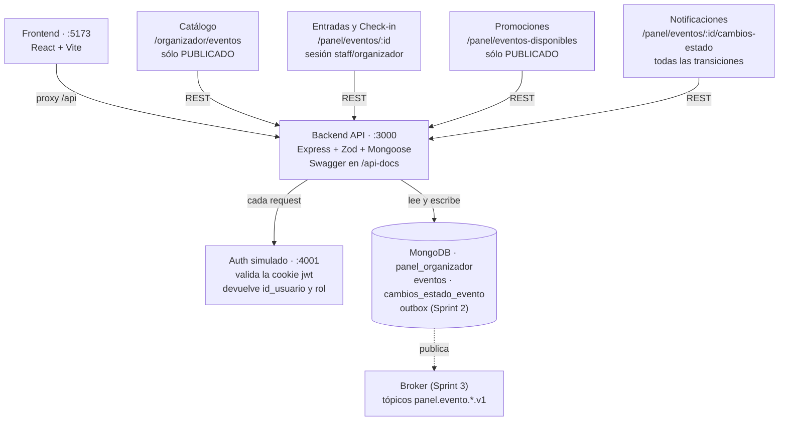

# Plan Sprint 2 — Panel Organizador

20/10/2026 · Joaquín Martínez · actualizado el 24/10/2026

El Sprint 2 cierra con el Avance 2, que los profesores movieron del 22/10 al **miércoles 28/10/2026**. El backend está completo en `main` (PR #11 y #12): edición (HU-02), mensajes salientes (INT-02) y las brechas de contrato que eran del backend. Falta el front de editar, la carpeta 08 de Postman, el tablero y los acuerdos con otros squads.

## Contenido

1. [Qué se entrega](#qué-se-entrega)
2. [Tareas por persona](#tareas-por-persona)
3. [Levantar todo en local](#levantar-todo-en-local)
4. [Mapa del flujo](#mapa-del-flujo)
5. [Dónde se ve cada cosa](#dónde-se-ve-cada-cosa)
6. [Referencia de la API](#referencia-de-la-api)
7. [Pruebas](#pruebas)
8. [Cómo funciona Postman](#cómo-funciona-postman)
9. [Brechas y preguntas abiertas](#brechas-y-preguntas-abiertas)

## Qué se entrega

El tablero (Projects #4) tiene 5 tarjetas en Sprint 2. Al 24/10, la parte de Panel de todas está hecha en el backend. Lo que falta para cerrarlas es el front de HU-02, Postman y los acuerdos con Catálogo y Entradas.

| Tarjeta | Responsables | Estado | Qué hay hoy | Qué falta para cerrarla |
| --- | --- | --- | --- | --- |
| HU-02 Editar un evento (#2) | Joaquín, Alonso | Backend hecho | `PATCH /mios/{id}` funciona (PR #11), con tests y Swagger sin `x-sprint: 2`. El front tiene `editarEvento()` en `eventsApi.js`, pero el lápiz muestra un aviso "Sprint 2". | Front: pantalla Editar. Postman: carpeta 08 Sprint 2. |
| HU-04 Publicar (#4, cerrada) | Joaquín, Etienne | Backend hecho | `POST /mios/{id}/publicar` funciona, exige `cantidad_entradas` y `tipo_entrada`, escribe el historial y deja los mensajes en el outbox. El botón Publicar está en Mis eventos. | Botón Publicar en el Detalle. El envío al broker es de HU-07 (Sprint 3). |
| INT-02 Abstracción del broker (#19) | Joaquín (+ Etienne) | Hecho | Interfaz `EventPublisher`, outbox `mensajes_salientes`, tópicos por variables de entorno y sobre `{ version, tipo, fecha_cambio, id_evento }` (PR #11). | Decidir qué broker usa el curso (Sprint 3). |
| INT-03 Catálogo (#20) | Etienne | Panel hecho | Los 3 GET/POST de Catálogo responden y nunca muestran BORRADOR. Publicar y editar un publicado ya dejan el mensaje para Catálogo. | Confirmar con Catálogo el tópico `panel.evento.catalogo.v1` y los campos. |
| INT-04 Entradas / Inventario (#21) | Etienne | Bloqueado | El GET compartido Entradas/Check-in funciona con sesión staff u organizador. | Entradas no ha confirmado `panel.evento.entradas.v1` ni `entradas.evento.stock.v1`. La capacidad reservada depende del endpoint de stock de Entradas. |

**Criterio de salida** ([`plan-proyecto.md`](plan-proyecto.md) §6.4): HU-02 cerrada por PR, Swagger sin `x-sprint: 2` en el PATCH, tests y Postman en verde, y la decisión del broker escrita. Sin esa decisión no puede empezar el Sprint 3 (HU-03 y HU-07).

## Tareas por persona

El PATCH del backend ya está en `main`, así que el front y Postman pueden avanzar en paralelo. Meta: todo mergeado en la rama de trabajo el **27/10 en la noche**, y el traspaso al repo del profesor el **28/10** antes de la presentación.

**Antes de empezar (todos):** el `main` del repo de presentación tiene 11 commits de Mariajosé (capturas y ajustes de CampoFormulario, LoginSimulado, EventoDetalle y `estandares-ui.md`) que no están en la rama de trabajo. Se sincronizan primero para que el traspaso no los pise.

### Joaquín — Backend (HU-02, INT-02)

> Todo lo de esta lista está en `main` desde el 20/10 (PR #11, 109 tests en verde). El Swagger quedó ordenado por sprint el 24/10 (PR #12), con el guion de la demo en [`api/README.md`](api/README.md).

- [x] `PATCH /api/v1/panel/eventos/mios/{id_evento}`: schema parcial (los mismos campos de `createEventoSchema`, todos opcionales, al menos uno, `strictObject`).
- [x] Reglas: sólo el dueño (403 `EVENT_NOT_OWNED`), sólo BORRADOR o PUBLICADO (FINALIZADO/CANCELADO → 409), fecha ≥ hoy, precio coherente con `tipo_entrada` sobre el evento ya fusionado.
- [x] Si el evento está PUBLICADO, el cambio no puede dejarlo sin un campo obligatorio para publicar (ej. `hora_fin_evento: null` → 400).
- [x] Si cambia `fecha_evento`, `hora_evento` o `hora_fin_evento` de un evento PUBLICADO, el mensaje lleva `tipo_cambio: REPROGRAMADO` (contrato Notificaciones).
- [x] INT-02: interfaz `EventPublisher` + implementación que escribe en el outbox y en el log. Tópicos desde `.env` (`TOPIC_CATALOGO`, `TOPIC_ENTRADAS`, `TOPIC_NOTIFICACIONES`, `TOPIC_CHECKIN`, `TOPIC_PROMOCIONES`). Publicar y editar escriben el mensaje después de guardar.
- [x] Publicar exige también `cantidad_entradas` y `tipo_entrada` (criterio de HU-04).
- [x] Respuesta JSON para rutas inexistentes (hoy Express devuelve una página HTML 404).
- [x] Tests `hu02-editar-evento.test.ts`, uno por criterio de aceptación y de autorización. Actualizar Swagger (quitar `x-sprint: 2` y el tag "Planificado").

### Alonso — Frontend (HU-02)

- [ ] Pantalla Editar en `/mis-eventos/:idEvento/editar`, reutilizando el formulario de `NuevoEventoPage.jsx` precargado con `obtenerEvento()`.
- [ ] El lápiz de la tarjeta y el botón Editar del Detalle llevan a esa pantalla (se quita el modal "Sprint 2").
- [ ] Botón Publicar en el Detalle, con el mismo modal de confirmación que en Mis eventos.
- [ ] Mostrar los errores 400 bajo cada campo (`detalles[].campo`) y el 409 como aviso.
- [ ] Corregir las desviaciones del estándar visual que lista [`ui/estandares-ui.md`](ui/estandares-ui.md) (UI3).

### Etienne — Integración (INT-03, INT-04)

- [ ] Cerrar con Catálogo, Entradas, Check-in y Notificaciones el broker y los nombres de tópico. Dejarlo escrito en los contratos y en ADR-0003.
- [ ] Confirmar con Entradas el endpoint de stock y qué hace al recibir CANCELADO.
- [ ] Carpeta "08 Sprint 2" en Postman junto con Christopher (ver [Cómo funciona Postman](#cómo-funciona-postman)).

### Christopher — QA / Base de Datos

- [ ] Revisar el schema parcial y las reglas de transición con Joaquín.
- [x] Si se agrega la colección del outbox: validador `$jsonSchema` en `database/schema/` y regenerar el diagrama ER y el diccionario con `npm run db:docs`. (Hecho junto con el backend en el PR #11: `03-mensajes_salientes.json`.)
- [x] Casos Postman de edición y publicación, y correr Newman completo antes del traspaso.

### Mariajosé — Scrum Master

- [ ] Tablero al día: HU-02 e INT-02 en *In progress* y luego *Done*. INT-03 e INT-04 con comentario de qué quedó hecho y qué espera a los otros squads.
- [ ] Cerrar HU-04 cuando el mensaje al broker quede escrito (su comentario lo condiciona a HU-07; conviene decidir si se cierra con el outbox).
- [ ] Minuta de acuerdos con los otros squads y guion de la demo del Avance 2.

## Levantar todo en local

Con Docker y Node 26 instalados, desde la raíz del repo (el `.env` sale de copiar `.env.example`):

```bash
npm ci
npm run infra:up     # MongoDB 7 en :27017 y el Auth simulado en :4001
npm run db:init      # crea las colecciones con sus validadores
npm run db:seed      # carga los 7 eventos de demo (borra los que había)
npm run dev:api      # backend en :3000, en otra terminal
npm run dev:web      # frontend en :5173, en otra terminal
```

| Qué | URL | Para qué |
| --- | --- | --- |
| Frontend | http://localhost:5173/login | Elegir un usuario de demo y usar el panel |
| Swagger | http://localhost:3000/api-docs | Ver y probar cada endpoint desde el navegador |
| Healthcheck | http://localhost:3000/health | Confirmar que el backend está arriba |
| MongoDB | `mongodb://localhost:27017/panel_organizador` | Abrirla en MongoDB Compass |
| Auth simulado | http://localhost:4001/internal/validar-sesion | Lo llama el backend; no se abre a mano |

**Usuarios de demo** (la cookie `jwt` que pone el login simulado): `token-org-a` y `token-org-b` (organizadores), `token-staff` (staff de Check-in), `token-asistente` (rol sin permiso) y `token-lento` (Auth tarda 3 s, sirve para mostrar el 503 fail-secure).

Sin Compass, la base se mira desde la terminal:

```bash
docker exec -it panel-organizador-mongo-1 mongosh panel_organizador
db.eventos.find({}, {nombre_evento: 1, estado_gestion: 1})
db.cambios_estado_evento.find().sort({fecha_cambio: -1}).limit(5)
```

## Mapa del flujo

Un evento sólo sale del panel cuando está PUBLICADO. Las flechas van de quien llama a quien responde.



El front sólo habla con el backend, y el backend valida la cookie con Auth en cada petición. Los otros squads leen del backend por REST hasta que exista el broker; el outbox del Sprint 2 deja los mensajes listos para él. Un BORRADOR sólo aparece en el historial de Notificaciones: Catálogo, Entradas y Check-in responden 404.

## Dónde se ve cada cosa

Cada acción del front deja dos rastros en MongoDB: el documento en `eventos` y una fila en `cambios_estado_evento`. Los otros squads sólo ven un evento cuando está PUBLICADO. Se probó en vivo el 20/10 y el 24/10 con un evento nuevo.

| Acción en el front | Endpoint que llama | Qué cambia en MongoDB | Qué ven los otros squads |
| --- | --- | --- | --- |
| Login simulado (`/login`) | Ninguno: pone la cookie `jwt` en el navegador | Nada | — |
| Abrir Mis eventos | `GET /api/v1/panel/eventos/mios` (el backend valida la cookie con Auth en cada petición) | Nada (sólo lee) | — |
| Crear evento (Nuevo evento → Guardar) | `POST /api/v1/panel/eventos` → 201 | `eventos`: documento nuevo con `estado_gestion: BORRADOR` e `id_organizador` = el usuario de Auth. `cambios_estado_evento`: fila `null → BORRADOR` | Nadie. Catálogo y Entradas/Check-in responden 404 para un BORRADOR. Sólo aparece en el historial de Notificaciones |
| Ver el detalle (clic en la tarjeta) | `GET /api/v1/panel/eventos/mios/{id}` | Nada. Otro organizador recibe 403 `EVENT_NOT_OWNED` | — |
| Publicar (botón en la tarjeta → confirmar) | `POST /api/v1/panel/eventos/mios/{id}/publicar` → 200 | `eventos`: `estado_gestion` pasa a `PUBLICADO` y se actualiza `fecha_actualizacion`. `cambios_estado_evento`: fila `BORRADOR → PUBLICADO` | Catálogo: aparece en `/organizador/eventos/proximos`, `/buscar` y `/{id}`. Entradas y Check-in: 200 en `/panel/eventos/{id}` con sesión staff u organizador. Promociones: aparece en `/panel/eventos-disponibles` |
| Editar (Sprint 2; hoy desde Swagger, la pantalla está pendiente) | `PATCH /api/v1/panel/eventos/mios/{id}` → 200 | `eventos`: el documento cambia. El estado no cambia, así que no hay fila nueva en el historial. `mensajes_salientes`: un mensaje por squad que debe enterarse | Si estaba PUBLICADO, ven los datos nuevos al consultar. Si cambió la fecha u hora, Notificaciones tiene un `evento_reprogramado` |
| Eliminar (Sprint 3) | `DELETE /api/v1/panel/eventos/mios/{id}` | Borrado físico o `CANCELADO`, según el stock en Entradas (HU-03) | Desaparece de Catálogo y Promociones |

### Cómo mostrarlo en la demo

Con 4 pestañas abiertas se ve el recorrido completo de un evento:

1. **Front** (`localhost:5173`): crear el evento como Org A. Queda con la insignia Borrador y el filtro por estado lo cuenta.
2. **Compass o mongosh**: el documento nuevo en `eventos` y su fila en `cambios_estado_evento`.
3. **Swagger** (`localhost:3000/api-docs`): ejecutar `GET /organizador/eventos/{id}` con ese id → 404, porque es borrador.
4. Publicar en el front y repetir: Swagger da 200, Compass muestra `PUBLICADO` y una segunda fila en el historial. `GET /panel/eventos/{id}/cambios-estado` devuelve las dos transiciones.

El id del evento sale de la URL del detalle (`/mis-eventos/<id>`) o de la respuesta del POST.

## Referencia de la API

El Swagger tiene 12 endpoints de negocio (más `/health`): 11 funcionan y 1 es del Sprint 3. Desde el 24/10 los grupos del Swagger van en el orden de los sprints. Los del organizador exigen la cookie `jwt` con rol `organizador`. Los de integración no llevan cookie (el acceso lo controla el gateway), salvo el GET que comparten Entradas y Check-in. El detalle completo está en [`api/openapi.yaml`](api/openapi.yaml).

| Endpoint | Quién lo usa | Sesión | Qué devuelve | Estado |
| --- | --- | --- | --- | --- |
| `POST /api/v1/panel/eventos` | Front (HU-01) | organizador | 201 con el evento en BORRADOR · 400 con `detalles` por campo | Funciona |
| `GET /api/v1/panel/eventos/mios` | Front (HU-05) | organizador | `{ eventos: [...] }` del usuario. Filtro opcional `?estado_gestion=PUBLICADO` | Funciona |
| `GET /api/v1/panel/eventos/mios/{id}` | Front (detalle) | organizador dueño | El evento completo · 403 si es de otro · 404 si no existe | Funciona |
| `POST /api/v1/panel/eventos/mios/{id}/publicar` | Front (HU-04) | organizador dueño | 200 PUBLICADO · 409 si no está en BORRADOR · 400 si faltan datos | Funciona |
| `PATCH /api/v1/panel/eventos/mios/{id}` | Front (HU-02) | organizador dueño | 200 con el evento actualizado · 409 si está FINALIZADO/CANCELADO | Sprint 2 |
| `DELETE /api/v1/panel/eventos/mios/{id}` | Front (HU-03) | organizador dueño | 204 · 409 si hay entradas vendidas | Sprint 3 |
| `GET /api/v1/organizador/eventos/proximos` | Catálogo | no | PUBLICADO con fecha ≥ hoy, con `estado_disponibilidad` | Funciona |
| `POST /api/v1/organizador/eventos/buscar` | Catálogo | no | PUBLICADO filtrado por `texto`, `categoria`, `fecha_desde`, `fecha_hasta` | Funciona |
| `GET /api/v1/organizador/eventos/{id}` | Catálogo | no | Un PUBLICADO · 404 para cualquier otro estado | Funciona |
| `GET /api/v1/panel/eventos/{id}` | Entradas y Check-in | staff u organizador | 10 campos (con `cantidad_entradas`, `tipo_entrada`, `hora_fin_evento`) · 404 si es BORRADOR | Funciona |
| `GET /api/v1/panel/eventos-disponibles` | Promociones | no | `id_evento`, `nombre_evento`, `fecha_evento` de los PUBLICADO | Funciona |
| `GET /api/v1/panel/eventos/{id}/cambios-estado` | Notificaciones | no | Historial de transiciones, la más nueva primero | Funciona |

**Errores** (todos los endpoints): `{ "error": { "codigo", "mensaje", "detalles"? } }`. 401 `SESSION_INVALID` sin cookie o con cookie inválida, 403 `FORBIDDEN_ROLE` con un rol sin permiso, 503 si Auth no responde (fail-secure: nunca se deja pasar).

**Cómo probar un endpoint sin el front:** en Swagger, "Try it out" con la cookie puesta en el navegador (iniciar sesión antes en `localhost:5173/login`), o con curl:

```bash
curl -H 'Cookie: jwt=token-org-a' localhost:3000/api/v1/panel/eventos/mios
curl -H 'Cookie: jwt=token-staff' localhost:3000/api/v1/panel/eventos/66f1a0000000000000000002
curl localhost:3000/api/v1/organizador/eventos/proximos
```

## Pruebas

Al 24/10 hay 109 tests automáticos en verde (eran 79 antes del Sprint 2) y 18 casos de Postman con 32 aserciones, también en verde. Los tests no necesitan Docker: levantan un MongoDB en memoria y un Auth falso.

| Qué | Comando | Qué revisa |
| --- | --- | --- |
| Tests del backend (Vitest + Supertest) | `npm test` | 8 archivos en `backend/tests/`: uno por HU (`hu01-`, `hu04-`, `hu05-`), autorización (`require-organizer`), cliente de Auth con timeout y reintento (`auth.client`), integraciones, validadores de la BD y contrato |
| Prueba de contrato | incluida en `npm test` | `contrato-openapi.test.ts`: cada respuesta real se valida contra el schema de `docs/api/openapi.yaml`. Si alguien cambia el código sin el Swagger, o al revés, falla |
| Pruebas de integración (Postman/Newman) | `npm run test:integration` | La colección contra el backend levantado de verdad. Necesita `infra:up`, `db:seed` y `dev:api` corriendo |
| CI (GitHub Actions) | automático en cada push y PR a `main` | Typecheck, `npm test`, lint del Swagger con Redocly y build del front. Newman **no** corre en CI: se corre a mano antes del traspaso |

### Casos nuevos del Sprint 2

En `backend/tests/hu02-editar-evento.test.ts`, uno por criterio:

- [x] El dueño edita un BORRADOR → 200 y el cambio queda guardado.
- [x] El dueño edita un PUBLICADO → 200 y se escribe un mensaje en el outbox.
- [x] Cambio de fecha u hora en un PUBLICADO → mensaje con `tipo_cambio: REPROGRAMADO`.
- [x] Evento FINALIZADO o CANCELADO → 409.
- [x] Cuerpo vacío, campo desconocido (`estado_gestion`, `id_organizador`) o formato inválido → 400 con `detalles`.
- [x] Fecha pasada, PAGADA sin precio, GRATUITA con precio → 400.
- [x] Quitar `hora_fin_evento` a un PUBLICADO → 400.
- [x] Otro organizador → 403 `EVENT_NOT_OWNED` · id inexistente → 404 · sin cookie → 401 · asistente → 403 · Auth caído → 503.
- [x] Contrato: el 200 del PATCH cumple el schema `Evento` del Swagger.

En `hu04-publicar-evento.test.ts`: publicar sin `cantidad_entradas` o sin `tipo_entrada` → 400. Para INT-02: cambiar un tópico en `.env` cambia el tópico del mensaje sin tocar código.

## Cómo funciona Postman

Postman es una colección de peticiones guardadas, cada una con un script que comprueba la respuesta. Newman es la misma colección corrida desde la terminal. Son dos archivos en `postman/`:

| Archivo | Qué tiene |
| --- | --- |
| `panel-organizador.postman_collection.json` | Las 18 peticiones en 7 carpetas: 01 Auth, 02 Catálogo, 03 Entradas, 04 Check-in, 05 Notificaciones, 06 Promociones y 07 Flujo HU-01→HU-05 |
| `local.postman_environment.json` | Las variables: `baseUrl` = `http://localhost:3000/api/v1`, `authUrl` = `http://localhost:4001/internal` y `nuevoEventoId` (vacía; la llena un caso) |

**Las 4 piezas de cada caso:**

1. **Nombre:** dice qué se prueba y qué se espera, por ejemplo "Caso: Org B pide el evento de A / Resultado esperado: 403".
2. **Petición:** método y URL con variables (`{{baseUrl}}/panel/eventos`), y el cuerpo JSON si es POST o PATCH.
3. **Sesión:** un header `Cookie: jwt=token-org-a`. Cambiando el token se prueba otro usuario o rol; sin el header se prueba el 401.
4. **Script de test** (pestaña *Scripts → Post-response*): aserciones `pm.test(...)` sobre el status y el cuerpo. Un caso puede guardar datos para el siguiente. Por ejemplo, "Crear evento" hace `pm.environment.set("nuevoEventoId", data.id_evento)` y los casos que vienen después usan `{{nuevoEventoId}}`.

**En la app de Postman:** *Import* → arrastrar los dos archivos → elegir el environment "Panel Organizador - Local" arriba a la derecha → clic derecho en la colección → *Run collection*. El runner corre las carpetas en orden y muestra cada aserción en verde o rojo. Antes hay que tener el backend levantado y la base recién cargada con `npm run db:seed`, porque varios casos usan los ids fijos del seed.

**Desde la terminal:** `npm run test:integration` corre Newman. Imprime la tabla de resultados y deja un reporte JUnit en `docs/evidencias/pruebas-integracion/newman-junit.xml`, que es la evidencia de la rúbrica.

### Carpeta "08 Sprint 2" (Etienne y Christopher)

Se agrega cuando el PATCH esté en la rama. Cada caso sigue el mismo formato de nombre:

- [x] Crear un borrador y guardar `{{nuevoEventoId}}`.
- [x] Editar ese borrador como Org A → 200 y el campo cambiado en la respuesta.
- [x] Editar como Org B → 403 `EVENT_NOT_OWNED` · sin cookie → 401 · cuerpo vacío → 400.
- [x] Publicarlo → 200, y después pedirlo a Catálogo (`/organizador/eventos/{{nuevoEventoId}}`) → 200.
- [x] Publicarlo otra vez → 409 `INVALID_STATE_TRANSITION`.
- [x] Editar el publicado (cambiar `hora_evento`) → 200, y Catálogo devuelve la hora nueva.
- [x] Historial (`/panel/eventos/{{nuevoEventoId}}/cambios-estado`) con 2 transiciones.

## Brechas y preguntas abiertas

Al probar todo el 20/10 aparecieron 5 diferencias entre lo acordado y lo que hace el código. Las 3 del backend se cerraron en el PR #11; quedan 2.

| Brecha | Lo acordado | Lo que pasa hoy | Quién |
| --- | --- | --- | --- |
| Campos para publicar | HU-04 exige nombre, fecha, hora inicio y fin, ubicación, cantidad y tipo de entrada | **Cerrada:** publicar sin `cantidad_entradas` o `tipo_entrada` → 400 | Joaquín |
| Formato de error para Check-in | `{ codigo_http, error, mensaje }` ([contrato Check-in](CONTRATO_PANEL_CHECKIN.md)) | **Pendiente:** `{ error: { codigo, mensaje } }` (ADR-0011 §3) | Etienne negocia o Joaquín adapta |
| Id con formato inválido | 400 ([contrato Entradas](CONTRATO_PANEL_ENTRADAS.md)) | **Cerrada:** 400 `INVALID_EVENT_ID` | Joaquín |
| Ruta inexistente | Error JSON como el resto | **Cerrada:** 404 `ROUTE_NOT_FOUND` en JSON | Joaquín |
| Newman en CI | Pruebas de integración como evidencia | **Cerrada:** automatizado en el workflow de CI con servicios | Christopher |

**Preguntas para cerrar esta semana:**

- [x] ¿Qué broker usa el curso y quién lo levanta? **Respondida 27/10:** el RabbitMQ compartido de la plataforma TicketU, que levanta la plataforma (ADR-0013).
- [ ] ¿Los otros squads confirman los tópicos `panel.evento.*.v1`? **Parcial:** Entradas ya recibe los mensajes; la plataforma propone `evento.creado` / `evento.cancelado`. Pendiente de decisión (minuta, compromiso 2b).
- [x] ¿HU-04 queda cerrada con el outbox o se reabre hasta HU-07? **Decidido 29/10:** queda cerrada; el aviso a otros squads es parte de HU-07 (comentario en #4).
- [ ] ¿Editar un PUBLICADO puede cambiar `cantidad_entradas`? Sigue pendiente con Entradas.
- [ ] ¿Notificaciones sigue usando `GET /cambios-estado`? **Parcial:** acordado que solo necesitan cancelación y reprogramación (minuta §1); falta confirmar el GET.
